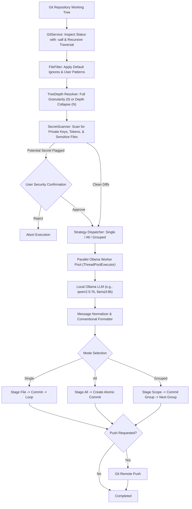

# Smart Committer

<p align="center">
  <pre align="center">
================================================================================
  ____  __  __    _    ____ _____     ____ ___  __  __ __  __ ___ _____ _____ _____ ____  
 / ___||  \/  |  / \  |  _ \_   _|   / ___/ _ \|  \/  |  \/  |_ _|_   _|_   _| ____|  _ \ 
 \___ \| |\/| | / _ \ | |_) || |    | |  | | | | |\/| | |\/| || |  | |   | | |  _| | |_) |
  ___) | |  | |/ ___ \|  _ < | |    | |__| |_| | |  | | |  | || |  | |   | | | |___|  _ < 
 |____/|_|  |_/_/   \_\_| \_\|_|     \____\___/|_|  |_|_|  |_|___| |_|   |_| |_____|_| \_\
================================================================================
  Local LLM Git Commit Automation Engine, Microservice Daemon, and Git Hook Integration
  </pre>
</p>

<p align="center">
  <a href="https://pypi.org/project/smart-committer/"></a>
  <a href="https://pypi.org/project/smart-committer/"></a>
  <a href="https://github.com/Kennny7/smart-committer/blob/main/LICENSE"></a>
  <a href="https://hub.docker.com/"></a>
  <a href="https://github.com/microsoft/winget-pkgs"></a>
  <a href="https://ollama.com/"></a>
  <a href="https://github.com/astral-sh/uv"></a>
  <a href="https://github.com/psf/black"></a>
</p>

---

## Table of Contents

- [Overview](#overview)
- [Execution Methods](#execution-methods)
  - [Method A: Using uv](#method-a-using-uv)
  - [Method B: Without uv (Standard Shell or Activated Virtualenv)](#method-b-without-uv-standard-shell-or-activated-virtualenv)
  - [Method C: Global System Command](#method-c-global-system-command)
- [Key Features](#key-features)
- [Architecture & Workflow](#architecture--workflow)
- [Installation Guide](#installation-guide)
  - [Install via uv](#install-via-uv-recommended)
  - [Install via Standard pip](#install-via-standard-pip)
  - [Windows Package Manager (Winget)](#windows-package-manager-winget)
  - [Standalone Binary Executables](#standalone-binary-executables-no-python-required)
  - [Docker & Docker Compose](#docker--docker-compose)
- [Repository Path Resolution](#repository-path-resolution)
- [Tree Depth & Subdirectory Traversal](#tree-depth--subdirectory-traversal)
- [Commit Modes](#commit-modes)
- [Configuration](#configuration)
  - [Environment Variables](#environment-variables)
  - [Default Ignore Rules](#default-ignore-rules)
- [Usage Guide & Examples](#usage-guide--examples)
  - [Common CLI Commands](#common-cli-commands)
  - [Interactive Mode](#interactive-mode)
  - [Commit Styles](#commit-styles)
  - [Parallel Processing](#parallel-processing)
- [Security Guard & Secret Scanner](#security-guard--secret-scanner)
- [Git Hook Integration](#git-hook-integration)
- [Microservice REST API Server](#microservice-rest-api-server)
  - [Starting the Daemon](#starting-the-daemon)
  - [API Endpoints Reference](#api-endpoints-reference)
- [Project Structure](#project-structure)
- [Troubleshooting & FAQ](#troubleshooting--faq)
- [License](#license)

---

## Overview

Smart Committer is an automated git commit assistant and microservice daemon powered entirely by local Large Language Models via [Ollama](https://ollama.com).

Unlike generic AI commit extensions that send private codebase diffs to cloud APIs, Smart Committer executes 100% locally on your machine. It inspects git status, reads diffs, evaluates security risks, and generates standard Conventional Commit messages with sub-second parallel processing.

---

## Execution Methods

Depending on your environment setup, choose the execution method that fits your workflow:

### Method A: Using uv

If you develop with Astral's `uv`, invoke Smart Committer using `uv run`. `uv` automatically locates the virtual environment and its dependencies without manual activation:

```bash
uv run smart-committer --mode single
```

### Method B: Without uv (Standard Shell or Activated Virtualenv)

If you run `smart-committer` directly in a standard terminal without `uv` and receive:
```text
'smart-committer' is not recognized as an internal or external command, operable program or batch file.
```

This occurs because the CLI executable resides inside the project's `.venv` directory, which is not yet added to your terminal `PATH`.

#### Option 1: Activate the virtual environment first
- **Windows (Command Prompt / PowerShell)**:
  ```powershell
  .venv\Scripts\activate
  smart-committer --mode single
  ```
- **Linux / macOS (Bash / Zsh)**:
  ```bash
  source .venv/bin/activate
  smart-committer --mode single
  ```

#### Option 2: Execute directly via Python module syntax
You can run the module directly through the virtual environment's Python executable without activating:
- **Windows**:
  ```powershell
  .venv\Scripts\python -m smart_committer --mode single
  ```
- **Linux / macOS**:
  ```bash
  .venv/bin/python -m smart_committer --mode single
  ```

### Method C: Global System Command

To make `smart-committer` permanently accessible from any terminal window across your entire operating system:

```bash
# Using uv tool install (recommended)
uv tool install .

# Or using global pip
pip install .
```
After global installation, typing `smart-committer` will work anywhere on your machine.

---

## Repository Path Resolution

Smart Committer automatically detects the target git repository:

### 1. Default Behavior (When `--path` is omitted)
When the `-p` / `--path` argument is omitted, Smart Committer automatically uses the **current working directory** (`Path.cwd()`) and navigates to the nearest enclosing git repository root (`git rev-parse --show-toplevel`).

```bash
# Run directly inside any git repository directory:
cd /path/to/my-repo
uv run smart-committer --mode single
```

### 2. Explicit Path (Targeting an external repository)
To run Smart Committer against a repository located in another folder:

```bash
uv run smart-committer --path /path/to/another-repo --mode single
```

---

## Tree Depth & Subdirectory Traversal

By default, Git status treats whole untracked directories as single entries (e.g. `?? src/`), which would cause nested files to be committed together as one folder. 

Smart Committer solves this by using deep status inspection (`-uall`) and recursive directory traversal:

- **Individual File Granularity (Default, `--tree-depth 0`)**:
  Smart Committer recursively inspects every subfolder. Every file at any depth (e.g., `src/smart_committer/cli.py`, `tests/test_file_filter.py`) is recognized as its own individual commit candidate.

- **Configurable Tree Depth (`--tree-depth N` / `--max-depth N`)**:
  If you intentionally wish to collapse changes at a specific directory level, pass `--tree-depth N`:

```bash
# Default: Deep traversal (individual commit per file at any depth)
uv run smart-committer --tree-depth 0

# Depth 1: Collapses changes into top-level directories (e.g. src/, tests/, scripts/)
uv run smart-committer --tree-depth 1

# Depth 2: Collapses changes at the second directory level (e.g. src/smart_committer/)
uv run smart-committer --tree-depth 2
```

<details>
<summary>Click to view comparison of Default Traversal vs. Depth Collapsing</summary>

```text
Default (--tree-depth 0):
  1. src/smart_committer/cli.py
  2. src/smart_committer/main.py
  3. tests/test_git_service.py
  4. README.md
  Total: 4 commits

Collapsed (--tree-depth 1):
  1. src/ (contains cli.py, main.py)
  2. tests/ (contains test_git_service.py)
  3. README.md
  Total: 3 commits
```
</details>

---

## Commit Modes

Smart Committer provides three distinct commit modes:

### 1. Single Mode (`--mode single` or default)
Commits each changed file individually. Ideal for granular contribution histories and isolated change inspection.
```bash
uv run smart-committer --mode single
```

### 2. All / Batch Mode (`--mode all` or `--all`)
Stages all eligible changes simultaneously and prompts the LLM for a single, comprehensive commit message summarizing the collective change set.
```bash
uv run smart-committer --all
```

### 3. Grouped Mode (`--mode grouped` or `--grouped`)
Partitions changes by directory or logical module (e.g. `src/api`, `docs`, `tests`), generating a separate scoped commit for each group.
```bash
uv run smart-committer --grouped
```

---

## Architecture & Workflow



---

## Installation Guide

### Install via uv (Recommended)

```bash
git clone https://github.com/Kennny7/smart-committer.git
cd smart-committer

# Global tool installation
uv tool install .

# Or virtual environment sync
uv sync
```

### Install via Standard pip

```bash
git clone https://github.com/Kennny7/smart-committer.git
cd smart-committer
pip install .
```

To include microservice REST API dependencies (`fastapi` and `uvicorn`):
```bash
pip install ".[server]"
```

### Windows Package Manager (Winget)

For Windows 10/11:
```powershell
winget install Kennny7.smart-committer
```

### Standalone Binary Executables (No Python Required)

Pre-compiled standalone executables are published with every release for Windows, Linux, and macOS:
1. Navigate to the [Releases](https://github.com/Kennny7/smart-committer/releases) page.
2. Download the binary matching your system (`smart-committer-windows-amd64.exe`, `smart-committer-linux-amd64`, or `smart-committer-darwin-universal`).
3. Add the executable to your system `PATH` and run directly.

### Docker & Docker Compose

Run Smart Committer alongside an isolated Ollama container:

```bash
git clone https://github.com/Kennny7/smart-committer.git
cd smart-committer

docker-compose up -d
curl http://localhost:8000/api/v1/health
```

---

## Configuration

Copy `.env.example` to `.env` in your project or home directory:
```bash
cp .env.example .env
```

### Environment Variables

| Variable | Default Value | Description |
| :--- | :--- | :--- |
| `OLLAMA_HOST` | `http://localhost:11434` | Endpoint of your running Ollama daemon |
| `OLLAMA_MODEL` | `qwen2.5:7b` | Ollama model name (`llama3:8b`, `mistral`, etc.) |
| `SMART_COMMITTER_MODE` | `single` | Default commit mode (`single`, `all`, `grouped`) |
| `SMART_COMMITTER_STYLE` | `conventional` | Commit format style (`conventional`, `simple`, `gitmoji`) |
| `SMART_COMMITTER_CONCURRENCY` | `4` | Worker threads for concurrent Ollama generation |
| `SMART_COMMITTER_SECRET_SCAN` | `true` | Prevent committing detected API credentials |
| `SMART_COMMITTER_HOST` | `127.0.0.1` | Bind host for microservice daemon |
| `SMART_COMMITTER_PORT` | `8000` | Port for microservice daemon |
| `LOG_DIR` | `~/.smart-committer/logs` | Destination directory for per-project audit logs |
| `MAX_FILE_PREVIEW` | `2500` | Maximum characters of file content sent to model |
| `MAX_DIFF_PREVIEW` | `3500` | Maximum characters of git diff sent to model |

<details>
<summary>Click to view Default Ignore Rules</summary>

Smart Committer automatically ignores the following file patterns unless explicitly overridden using `--force-include`:
- **Git metadata**: `.git/`, `.git/**`
- **Virtual environments**: `venv/`, `.venv/`, `env/`, `ENV/`
- **Node & Web artifacts**: `node_modules/`, `.next/`, `.nuxt/`, `dist/`, `build/`, `package-lock.json`, `yarn.lock`, `pnpm-lock.yaml`
- **Python artifacts**: `__pycache__/`, `*.py[cod]`, `*.egg-info/`, `.pytest_cache/`, `.mypy_cache/`, `.ruff_cache/`
- **Sensitive files**: `.env`, `.env.*` (except `.env.example`), `*.pem`, `*.key`, `*.pfx`, `id_rsa*`, `credentials.json`
- **Databases & Logs**: `*.db`, `*.sqlite`, `*.sqlite3`, `*.log`, `logs/`
- **Compiled binaries**: `*.exe`, `*.dll`, `*.so`, `*.dylib`, `target/` (Rust)

</details>

---

## Usage Guide & Examples

### Common CLI Commands

#### Dry-run preview without committing
```bash
uv run smart-committer --dry-run
```

#### Filter specific files
```bash
# Include only python files inside src/
uv run smart-committer -i 'src/**/*.py'

# Exclude markdown and documentation
uv run smart-committer -e '*.md' -e 'docs/**'

# Force include a file normally ignored by defaults
uv run smart-committer --force-include '.env.production'
```

#### Limit number of commits
```bash
# Process at most 5 files
uv run smart-committer --limit 5
```

#### Automatically sign commits and push
```bash
uv run smart-committer -s --push -y
```

#### List available local Ollama models
```bash
uv run smart-committer models
```

---

### Interactive Mode

Review and modify each commit message before execution:
```bash
uv run smart-committer --interactive
```
The terminal displays an editable prompt pre-filled with the AI-suggested message. Press Enter to confirm, type adjustments, or press Escape/Ctrl+C to skip that file.

---

### Commit Styles

Customize output format using `--style`:

- **conventional** (default):
  `feat(auth): add jwt token refresh handler`
- **simple**:
  `Add JWT token refresh handler`
- **gitmoji**:
  `[FEAT] add jwt token refresh handler`

Example:
```bash
uv run smart-committer --style simple
```

---

### Parallel Processing

When processing dozens of changes, Smart Committer parallelizes message generation across worker threads. Configure concurrency via `--concurrency`:
```bash
uv run smart-committer --concurrency 8
```
A live terminal progress bar tracks real-time generation and completion across worker threads before committing begins.

---

## Security Guard & Secret Scanner

Automated commits carry the danger of accidentally committing secrets. Smart Committer incorporates an active pattern scanner that inspects file names, content, and diffs for:
- Private Cryptographic Keys (`BEGIN RSA/DSA/EC/OPENSSH PRIVATE KEY`)
- AWS Access Key IDs (`AKIA...`) and Secret Keys
- GitHub Personal Access Tokens (`ghp_...`, `gho_...`)
- Slack Bot and User Tokens (`xoxb-...`)
- Generic API Keys and Bearer Tokens
- Database Connection Strings (`postgres://`, `mongodb://`, `mysql://`)
- JSON Web Tokens (`eyJ...`)

If an eligible file contains sensitive patterns, Smart Committer displays an alert table highlighting line numbers and redacted snippets, and requires explicit confirmation.

To bypass scanning in automated CI environments:
```bash
uv run smart-committer --skip-secret-scan
```

---

## Git Hook Integration

Integrate Smart Committer into standard `git commit` workflows.

### Install the prepare-commit-msg hook
```bash
uv run smart-committer hook install
```
This writes an executable `.git/hooks/prepare-commit-msg` script inside your current repository. Whenever you stage files and run `git commit` with no message flag (`-m`), Smart Committer generates a message based on staged diffs and pre-populates your editor.

### Uninstall the hook
```bash
uv run smart-committer hook uninstall
```

---

## Microservice REST API Server

Run Smart Committer as a local microservice daemon to enable editor integrations (VS Code extensions, Neovim plugins) or local automation scripts.

### Starting the Daemon

```bash
uv run smart-committer serve --host 127.0.0.1 --port 8000
```

Interactive OpenAPI Swagger UI is available at:
`http://127.0.0.1:8000/docs`

<details>
<summary>Click to view REST API Endpoints Reference</summary>

#### 1. System Health Check
```http
GET /api/v1/health
```
**Response (200 OK):**
```json
{
  "status": "ok",
  "version": "0.2.0",
  "ollama_host": "http://localhost:11434",
  "ollama_model": "qwen2.5:7b",
  "ollama_reachable": true,
  "available_models": ["qwen2.5:7b", "llama3:8b"]
}
```

#### 2. Query Repository Status
```http
POST /api/v1/status
Content-Type: application/json

{
  "repo_path": ".",
  "tree_depth": 0,
  "include": [],
  "exclude": []
}
```

#### 3. Preview Generated Messages
```http
POST /api/v1/preview
Content-Type: application/json

{
  "repo_path": ".",
  "mode": "all",
  "style": "conventional",
  "tree_depth": 0
}
```

#### 4. Trigger Commit Execution
```http
POST /api/v1/commit
Content-Type: application/json

{
  "repo_path": ".",
  "mode": "single",
  "style": "conventional",
  "tree_depth": 0,
  "push": false,
  "signoff": true,
  "skip_secret_scan": false
}
```

#### 5. Generate Message from Raw Diff
```http
POST /api/v1/generate
Content-Type: application/json

{
  "diff_text": "diff --git a/src/main.py b/src/main.py\n+print('hello')",
  "style": "conventional",
  "scope_hint": "core"
}
```

</details>

---

## Project Structure

```text
smart-committer/
├── .github/
│   └── workflows/
│       └── release.yml          # Automated CI/CD, PyPI & binary release pipeline
├── distribution/
│   └── winget/
│       └── smart-committer.yaml # Windows Package Manager manifest definition
├── scripts/
│   └── build_executable.py      # Cross-platform PyInstaller binary build script
├── src/
│   └── smart_committer/
│       ├── __init__.py          # Version definition and package exports
│       ├── __main__.py          # Executable entrypoint
│       ├── cli.py               # Terminal UI, command runner, and progress views
│       ├── config.py            # Environment and runtime configuration loader
│       ├── file_filter.py       # Pattern match engine and default ignore lists
│       ├── git_service.py       # Low-level Git operations, diffs, and hook installer
│       ├── logger.py            # Per-project rotating file logger
│       ├── main.py              # CLI argument parser and command dispatcher
│       ├── models.py            # Enums and data structures
│       ├── ollama_service.py    # Local Ollama client with parallel generation
│       ├── py.typed             # PEP 561 typing marker
│       ├── secret_scanner.py    # Credential and sensitive pattern detector
│       ├── server.py            # FastAPI REST microservice daemon
│       └── utils.py             # Content truncation and preview generators
├── tests/
│   ├── test_file_filter.py      # Ignore and filter pattern unit tests
│   ├── test_git_service.py      # Tree depth and repository unit tests
│   ├── test_models.py           # Model enum tests
│   ├── test_ollama_service.py   # Fallback and prompt tests
│   └── test_secret_scanner.py   # Secret detection validation tests
├── .env.example                 # Environment configuration template
├── .gitignore                   # Git exclusion rules (includes private docs)
├── docker-compose.yml           # Multi-container orchestration (App + Ollama)
├── Dockerfile                   # Multi-stage production container build
├── LICENSE                      # MIT Open Source License
├── pyproject.toml               # Package build specifications (Hatchling / uv)
├── smart-committer.spec         # PyInstaller standalone build configuration
└── README.md                    # Comprehensive documentation
```

---

## Troubleshooting & FAQ

### 'smart-committer' is not recognized as an internal or external command
This happens when you run in a fresh shell without activating the project virtualenv.
- Run via `uv run smart-committer`
- Or activate the environment: `.venv\Scripts\activate` (Windows) or `source .venv/bin/activate` (Linux/macOS)
- Or install globally: `uv tool install .`

### Ollama is unreachable
- Verify that Ollama is active by visiting `http://localhost:11434` in your browser.
- Ensure the Ollama background service is running:
  - Linux: `systemctl status ollama`
  - macOS / Windows: Verify the Ollama taskbar app is running.
- If Ollama is on a custom port or remote host, set `OLLAMA_HOST=http://your-host:port`.

### Model not found
- Run `ollama list` in your terminal to see downloaded models.
- Download a recommended model:
  ```bash
  ollama pull qwen2.5:7b
  ```
- Or pass the model directly via the CLI:
  ```bash
  uv run smart-committer -m llama3:8b
  ```

### Accidental .env or secret warning
Smart Committer halts when detecting possible secrets in changed files. If the file is legitimate:
- Pass `--skip-secret-scan` to proceed anyway.
- Or use `--force-include <file>` if it was skipped by default ignore patterns.

---

## License

This project is open-source software licensed under the [MIT License](LICENSE).
